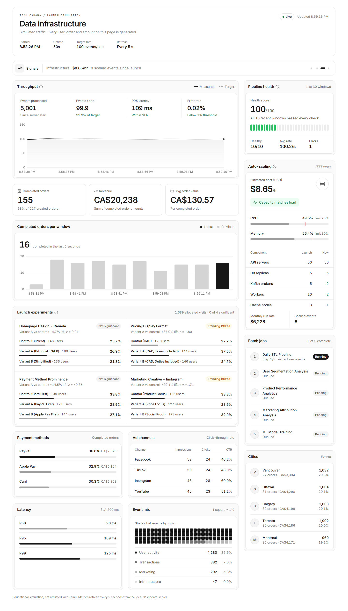

# Temu Canada Launch: Data Infrastructure Simulation

> **Note:** This is an educational simulation, not Temu's real system. It is not affiliated with or endorsed by Temu or PDD Holdings. All events, users, orders and revenue are randomly generated, and the architecture is my own reconstruction of what a launch like this might need.



*The live dashboard (`npm run dashboard`) after about 50 seconds. Every panel is computed by the project's own modules: business figures from the event stream, cost and instance counts from the auto-scaler, experiment results from the A/B testing platform, and job status from the batch processor. All A/B variants share the same 30% conversion rate, so any "significant" or "trending" result is a false positive from small early samples, the kind of result a real launch team should not act on.*

## Overview

When Temu launched in Canada, most people saw the advertising on Facebook, Instagram, YouTube and TikTok. The less visible part was the data infrastructure: handling millions of users across six time zones, real-time analytics, and sudden traffic spikes from day one, while keeping customer data in Canada.

This project models that infrastructure in Node.js. It generates a realistic stream of user, transaction, marketing and infrastructure events from Toronto, Montreal, Vancouver, Calgary and Ottawa, priced in Canadian dollars, and processes it in real time. It also auto-scales simulated infrastructure, runs A/B tests on Canadian launch decisions such as a bilingual English/French homepage, showing prices with taxes or duties included, and PayPal or Apple Pay vs card checkout, and shows everything on a live dashboard.

## Results From a Sample Run

These numbers come from a 95-second run of `npm run demo` on Windows 11 with Node 25. Latency and error rates are simulated values, not network measurements.

| Area | What I observed |
| --- | --- |
| Throughput | 9,494 events in 95 s: **99.9 events/sec** against a 100/sec target |
| Latency | p50 100 ms, p95 110 ms, p99 114 ms |
| Error rate | **0.09%** (8 failed events, against a 0.1% injected failure rate) |
| Traffic mix | 85% user events, 8% transactions, 5.7% marketing, 1.2% infrastructure |
| Auto-scaling | 6 scale-down rounds: Kafka brokers 5 → 2, workers 10 → 4, cache nodes 3 → 1 |
| Cost | Estimated cost fell from **$10.80/hr to $9.05/hr** (about 16%) once capacity matched load |
| A/B tests | 4 experiments, 15–26 users per variant, conversion 26–45%, **none statistically significant** |

What the run showed:

- **The launch capacity was over-provisioned for steady traffic.** The autoscaler spent the run shrinking the cluster. That is the right call before a launch, but it shows what idle headroom costs.
- **A/B tests need far more traffic than a demo provides.** With 10% of traffic allocated to experiments, each variant got about 20 users a minute, nowhere near enough to detect a real difference. A real launch would need hours or days per test.
- **Timer precision matters.** Before I fixed the event loop, the processor delivered only about 52 events/sec on Windows, because `setTimeout` cannot fire more often than about every 15 ms there. It now catches up based on elapsed time.

## Architecture Modeled

The simulation models these components in code. It does not run actual Kafka, Flink or Snowflake clusters.

### 1. Data Ingestion Layer
- **Real-time Event Streaming**: Kafka/Kinesis for user events, ad clicks, transactions
- **API Gateway**: Centralized entry point for all data sources
- **CDN Log Aggregation**: Edge server logs from CloudFlare/AWS CloudFront
- **Social Media Analytics**: Data pipelines from Instagram, X, YouTube APIs
- **Mobile App Telemetry**: Real-time user behavior tracking

### 2. Data Processing Layer
- **Stream Processing**: Apache Flink/Spark Streaming for real-time analytics
- **Batch Processing**: ETL pipelines for historical analysis
- **Data Transformation**: Normalization, enrichment, deduplication
- **Machine Learning Pipelines**: Recommendation engines, fraud detection

### 3. Data Storage Layer
- **Data Warehouse**: Snowflake/BigQuery for analytical queries
- **Data Lake**: S3/GCS for raw data storage
- **Time-Series DB**: InfluxDB/TimescaleDB for metrics
- **Cache Layer**: Redis for hot data access
- **Search Index**: Elasticsearch for product search analytics

### 4. Analytics & Monitoring
- **Real-time Dashboards**: Grafana/Tableau for operational metrics
- **Business Intelligence**: Power BI/Looker for executive reporting
- **A/B Testing Platform**: Custom experimentation framework
- **Alerting System**: PagerDuty/DataDog for anomaly detection

### 5. Infrastructure
- **Multi-Region Deployment**: AWS ca-central-1 (Montreal) and ca-west-1 (Calgary), keeping customer data in Canada for PIPEDA and Quebec's Law 25
- **Auto-scaling**: Kubernetes clusters with HPA
- **Load Balancing**: Geographic routing for optimal latency
- **Disaster Recovery**: Multi-AZ with automated failover

See [architecture/system-design.md](architecture/system-design.md) and [architecture/data-flow.md](architecture/data-flow.md) for more detail.

## Running the Simulation

```bash
# Install dependencies
npm install

# Run the complete demo (recommended); press Ctrl+C for the final summary
npm run demo

# Or run individual components:
npm run dashboard     # live dashboard at http://localhost:3000/monitoring/dashboard.html
npm run pipeline      # real-time event processor only
npm run stress-test   # infrastructure load generator
npm run ab-test       # A/B testing simulation (2 minutes)
npm run batch         # scheduled batch jobs
```

Batch job steps are timed like real jobs and take minutes each (ML training takes 10–30 minutes), so a short demo shows the ETL job still in progress.

## Project Structure

```
Temu-Canada-data-infrastructure-simulation/
├── README.md
├── OVERVIEW.md
├── HOW_IT_WORKS.md
├── demo.js                       # runs every component together
├── architecture/
│   ├── system-design.md
│   └── data-flow.md
├── pipelines/
│   ├── real-time-processor.js    # event generation and stream processing
│   └── batch-processor.js        # ETL, segmentation, ML training jobs
├── monitoring/
│   ├── dashboard-server.js       # Express + Socket.IO metrics server
│   └── dashboard.html            # live Chart.js dashboard
├── infrastructure/
│   ├── scaling-simulator.js      # auto-scaling and cost model
│   └── load-generator.js         # stress test scenarios
├── analytics/
│   └── ab-testing.js             # experimentation platform
├── docs/
│   └── dashboard.png
└── package.json
```
